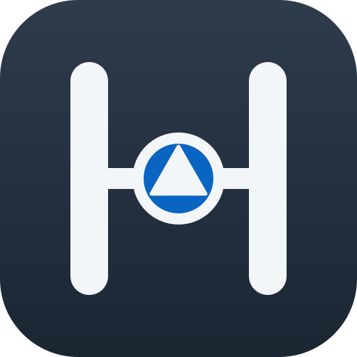
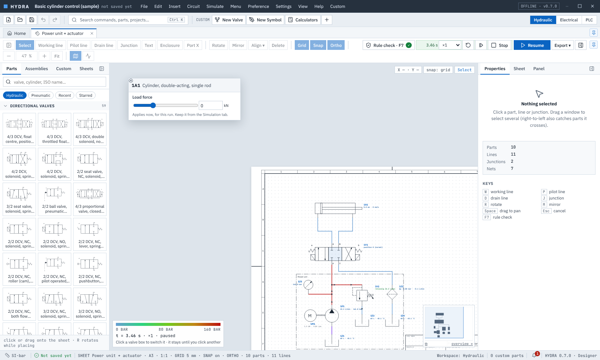
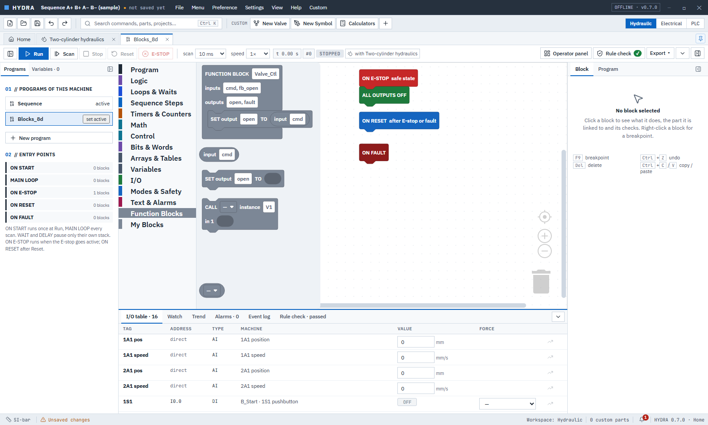
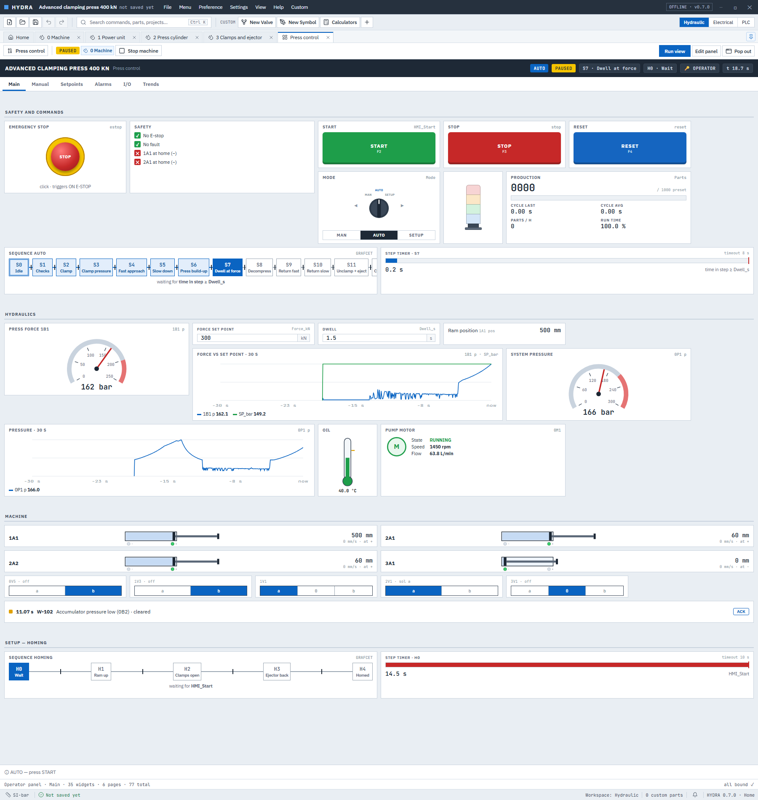
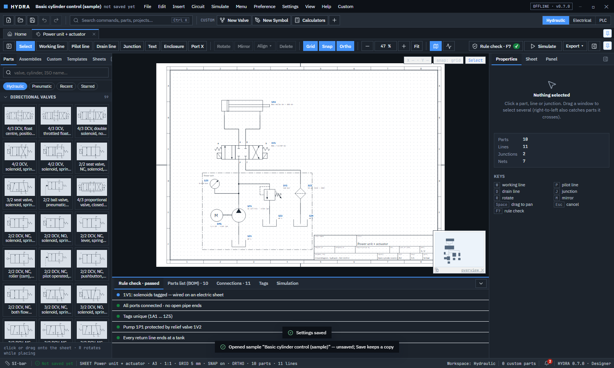

<p align="center"></p>

# HYDRA

**Offline 2D CAD and simulator for hydraulic, pneumatic and electrical circuits, with a block-based PLC and operator panels.**

HYDRA runs entirely in your browser from a folder on your disk: no installation, no admin rights, no internet, no
account. Fluid-power symbols follow **ISO 1219**; electrical symbols follow **IEC 60617**.



## Features
- **Circuit Designer**: hydraulic and pneumatic sheets.
  - ISO 1219 part library: valves, pumps, cylinders, accumulators, filters, sensors…
  - Port-to-port working, pilot and drain lines, ISO 1219-2 tags, values for each placed part.
  - Assemblies with interface ports, and machine sheets that combine them.
  - Rule check (F7).
  - Export to vector PDF, SVG, PNG, DXF (R12), a parts list (Excel / CSV) and a netlist.
- **Simulation (F5)**: lumped-parameter hydraulics and pneumatics.
  - Pressure colours, moving cylinders, live values, graphs.
  - Click a valve to switch it.
- **Electric Designer**: ladder diagrams, motor starters, PLC I/O cards. Parts link to the fluid side by tag.
- **Logic Coder**: a PLC programmed in Blockly.
  - GRAFCET sequences with parallel branches.
  - Timers, counters, PID, ramps and filters; arrays, tables and records; function blocks.
  - Handshakes, machine modes, alarm groups, two-hand and dual-channel safety blocks.
  - Runs scan by scan, standalone or driving the simulation.
- **Operator panels**: 40 HMI widgets, auto-built from your project. Show the panel docked, in a tab, or in a second window.
- **Valve Creator and Symbol Sketcher**: draw your own ISO symbols into a custom library.
- **AI assistant (optional, off by default)**: turn it on in *Settings › AI & Connections* (desktop app).
  - Chat in HYDRA's AI panel through your own Claude Code or Codex CLI, or your own Anthropic / OpenAI API key; or let Claude Desktop use HYDRA's tools (MCP).
  - The AI asks a few questions, proposes a parts list (HYDRA adds required parts such as the relief valve), then draws the circuit.
  - After a circuit is applied, **Create Electric / Logic Code / Controller-HMI** generate the PLC I/O sheets, the PLC program and the operator panel from its tags.
  - Every AI change is shown as a faded preview, checked by the solver, and applied only when you press **Apply**, as one undo step.
  - Projects marked **Private** are never sent to any AI.
- **Themes**: Stitch (default), Light Grey, Graphite Dark, Blueprint, High Contrast, or your own colours.
- **Samples**: six teaching circuits and one complete machine, a 400 kN clamping press.
  - The press includes a power unit, press and clamp sheets, electric and PLC sheets, a PLC program and an operator panel.

| Logic Coder | Operator panel | Graphite Dark theme |
|---|---|---|
|  |  |  |

## Download and run
1. Download `HYDRA-<version>.zip` from the [Releases](../../releases) page and unzip it anywhere.
2. Double-click **`HYDRA.html`**. It opens in Chrome or Edge. Firefox works, except for direct file saving.

Or double-click **`HYDRA.bat`** (Windows). It starts a small server that only this PC can reach (`http://localhost:17171`)
and opens HYDRA in its own window. This adds:
- a project folder, `Documents\HYDRA`, with Save / Open;
- automatic backups (newest 10 per project) and autosave;
- *File › Install HYDRA as an App*.

Keep the folder together: `HYDRA.html` loads `app/`, `lib/` and `tools/` from next to it.

## Build from source
Requires [Node.js](https://nodejs.org) 18 or newer.
```
cd app
npm install
node build.mjs          # → dist/HYDRA/  (HYDRA.html, HYDRA.bat, app/, lib/, tools/, …)
```
`npm run typecheck` runs the TypeScript checker.

### Windows desktop app (optional)
`desktop/` builds **HYDRA.exe** with [Tauri 2](https://tauri.app): an installer, an MSI and a portable exe.
On GitHub: open the **Actions** tab, choose **Build HYDRA (Windows)**, then **Run workflow**. The exe, installer and MSI
appear as a download when it finishes; publishing a release with a tag such as `v0.8.0` also attaches them to it.
To build on your own PC see [desktop/BUILD_WINDOWS.md](desktop/BUILD_WINDOWS.md). The browser build above is the reference build;
the exe wraps the same app in a native window.

## Tests
End-to-end suites drive the built app in Chromium with [Playwright](https://playwright.dev/python/). See
[tests/README.md](tests/README.md).
```
pip install playwright
python -m playwright install chromium
python tests/s8a.py      # each suite prints "N / N"
```

## Project layout
| Folder | Contents |
|---|---|
| `app/src/` | The application (Preact + signals, immer, esbuild). `designer/` CAD and simulation, `plc/` Logic Coder and operator panel, `machines/` the sample-machine generator |
| `app/launcher/` | `HYDRA.bat` and its PowerShell localhost server |
| `app/assets/` | Fonts, icons, the prebuilt Valve Creator and Symbol Sketcher |
| `tools-src/` | Sources of the Valve Creator and Symbol Sketcher |
| `desktop/` | Tauri 2 project for HYDRA.exe |
| `tests/` | Playwright regression suites |
| `docs/images/` | Screenshots used in this README |

## Known limitations
- The simulator is a teaching and design aid, not a certified calculation tool. Check real machines with the
  manufacturers' data and your own engineering judgement.
- Two simulator issues are known:
  - The 2/2 *seat* valve (`v_22_seat`) passes flow at rest.
  - The return spring of the single-acting, spring-return cylinder (`h_cyl_single`) pushes towards extension.
  - Until they are fixed, use the 2/2 directional valve, and the single-acting cylinder with return by external force.
- Electric circuits are drawn and checked, not simulated.
- Projects, libraries and settings are kept in the browser profile you open HYDRA with (or in `Documents\HYDRA` when
  you use HYDRA.bat). Clearing site data in the browser removes the browser-stored copies.

## Contributing
Issues and pull requests are welcome. See [CONTRIBUTING.md](CONTRIBUTING.md).

## Licence
HYDRA is created by **Jignesh** and released under the [MIT licence](LICENSE). The sample circuits and the sample machine are original designs,
available under MIT or CC BY 4.0. Bundled libraries and fonts keep their own licences:
see [THIRD_PARTY_NOTICES.md](THIRD_PARTY_NOTICES.md).
